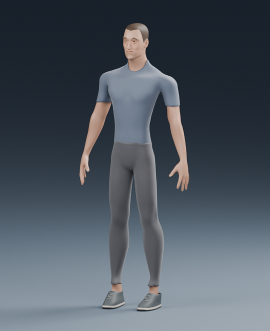

# Atelier guidé — Character Artist

Ouvrez une copie du personnage. Comparez les images 1, 25 et 49. Faites les corrections visuelles sur une copie et conservez la version pondérée. [Réimport vérifié](../../02_MODELING/PARCOURS_PRATIQUE/projet-humain.md).

## 1. Sculpt et silhouette

Sur une copie, choisissez une vue de face, profil et trois-quarts. Corrigez une transition de joue ou de cheville sur une version de travail avec un pinceau à rayon large.

**Pourquoi** Une silhouette s’évalue par masses et profils avant le détail. Un sculpt dense exige une cage destinée au rig.

**Contrôle** Trois vues neutres avant/après et une cage conservée.

## 2. Vêtement et cheveux

Contrôlez le pantalon en pose et la ligne d’implantation des cheveux. Comparez une mèche proche et une masse qui reste lisible de loin. Corrigez une intersection en pose.

**Pourquoi** La géométrie de vêtement doit tenir à distance du corps là où il se plie. Les cheveux se lisent d’abord comme une masse.

**Contrôle** Au moins une correction vérifiée sur deux poses et visible dans le filaire.

## 3. Portfolio et livraison

Générez une rotation de 360 degrés sur 96 images à 24 i/s, caméra fixe ou pivot central. Présentez argile, matériaux et filaire. Testez le .blend rouvert.

**Pourquoi** Une présentation crédible montre les choix de surface et les limites du rig. Une rotation révèle ce que le portrait de trois-quarts masque.

**Contrôle** Un turntable de 4 s, trois vues fixes, une image de pose et une fiche de contribution.

## Vérification sur une variante

Comparez neutre et deux poses de flexion au même cadre. Corrigez une seule zone et évaluez le changement en filaire puis en matériau. Documentez votre contribution sur la base utilisée.
