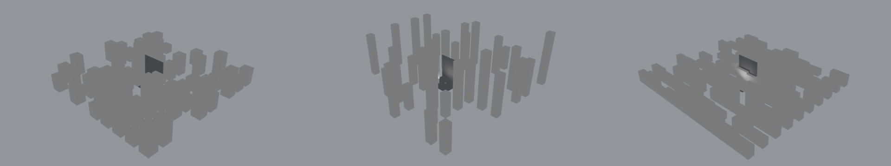

# Atelier guidé — Environment Artist

Sur une copie du quai, activez l’accrochage à l’incrément ou aux sommets. Construisez le kit en unités métriques. Comparez le [projet Geometry Nodes](../../05_GEOMETRY_NODES/PROJECT_P5/README.md) avant de publier votre modificateur.

## 1. Kit modulaire

Construisez segment de sol, poteau, garde-corps et terminaison avec une grille d’un mètre. Placez les origines sur les points de raccord.

**Pourquoi** Un kit cohérent résout les raccords avant la production en série. Appliquer l’échelle permet de comparer dimensions et snapping.

**Contrôle** Quatre modules et deux assemblages qui se raccordent sans interstice.

## 2. Distribution et histoire

Créez une distribution Geometry Nodes pour de petits accessoires. Utilisez un masque de densité pour dégager le chemin vers la balise et fixez la graine.

**Pourquoi** Le vide fait partie de la composition. La graine stable permet de reproduire un contrôle visuel.

**Contrôle** Une vue d’ensemble montre le chemin, le principal point focal et le masque.

## 3. Budget

Comparez instances et réalisation explicite sur une copie. Notez nombre d’objets, triangles évalués, taille du fichier et temps de lecture à géométrie comparable.

**Pourquoi** Réaliser les instances a un coût. Mesurez ce qui change dans le contexte de livraison.

**Contrôle** Un tableau chiffre deux versions et justifie laquelle garder.

## Vérification sur une variante

Assemblez deux segments par accrochage, puis ouvrez la variante de nuit. Faites mesurer deux versions de densités différentes et identifiez le chemin lisible à l’écran.
