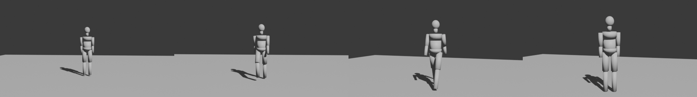

# Atelier guidé — Animator

Utilisez Timeline et Dope Sheet pour le blocking. Passez ensuite au Graph Editor et utilisez un repère visuel ajouté au point d’appui. [Contrôle de marche Blender](../../PROPOSITIONS/RECONSTRUCTION_2_VUES/verification_marche.json).

## 1. Intention et blocking

Écrivez une intention en verbe, par exemple cacher ou rassurer. Posez anticipation, geste principal et réaction en Constant avec les mêmes contraintes de caméra.

**Pourquoi** L’acting repose sur un changement lisible. Les poses principales doivent porter la décision avant le détail.

**Contrôle** Une lecture muette distingue les trois moments et le spectateur identifie le verbe.

## 2. Mécanique et courbes

Dans la marche, comparez centre de masse et pied porteur. Corrigez une dérive d’appui puis inspectez le spacing et les dépassements dans le Graph Editor.

**Pourquoi** Le transfert de poids précède ou accompagne le pas. Un pied planté reste au même point dans le repère monde pendant son appui.

**Contrôle** Le contact ne glisse plus pendant sa plage et le bassin ne fait pas de ressaut.

## 3. Reel et retour

Montez 15 à 30 secondes avec le plan le plus lisible en premier. Pour chaque extrait, indiquez contribution et contraintes réellement traitées.

**Pourquoi** Le reel choisit des preuves observables. Un extrait trop long masque parfois le passage que l’on veut défendre.

**Contrôle** Un MP4 avec un plan d’acting, une action physique et des contributions claires.

## Vérification sur une variante

Prenez un passage de trois actions. Testez deux regards à timing égal, puis comparez deux appuis à la vue de côté. Indiquez dans le reel quelles corrections sont les vôtres.
