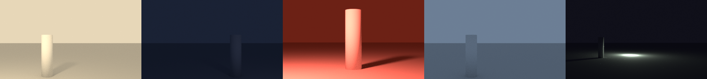

# Atelier guidé — Lighting Artist

Échantillonnez la fin de S010, le début et la fin de S020 ainsi que le début de S030. Faites les rendus avec la même solution d’affichage. [Planche de comparaison P9](../../09_CINEMATOGRAPHY/PROJECT_P9/REFERENCE/renders/p9_contact_sheet.png).

## 1. Références et lookdev

Choisissez une sphère grise, un blanc d’étalonnage et un témoin ocre. Fixez la transformation d’affichage et l’exposition de comparaison.

**Pourquoi** Le lookdev se compare avec une chaîne couleur stable. Une modification de la lumière doit être distinguée de l’affichage.

**Contrôle** Deux témoins visibles dans les rendus de test et une configuration de couleur notée.

## 2. Continuité et exception

Éclairez S010 et S020 avec une direction de clé cohérente. Sur S030, créez un accent ocre motivé par l’allumage.

**Pourquoi** Une exception d’éclairage est lisible quand elle découle d’un événement. Les raccords proches exigent une direction crédible.

**Contrôle** Le changement de luminance est narratif, tandis que la silhouette et le fond restent comparables.

## 3. Dailies et coût

Tirez des frames autour des coupes. Vérifiez les niveaux de gris et chronométrez deux budgets d’échantillons au même cadre.

**Pourquoi** La revue de séquence révèle les ruptures que des images isolées cachent. Une mesure doit comparer le même contenu.

**Contrôle** Une planche avec trois fenêtres, une recommandation de budget et un défaut résolu.

## Vérification sur une variante

Choisissez deux cadres de part et d’autre de la coupe. Comparez une sphère témoin et une ombre de silhouette. Précisez quelle lampe change et quel réglage d’affichage reste fixe.
