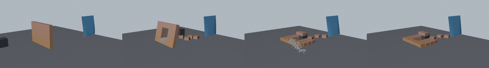

# Atelier guidé — VFX Artist

Commencez par le système et sa plage dans [l’atelier des caches](../../08_SIMULATIONS/CH08_10_CACHES/README.md). Gardez une simulation stable pour l’essai des passes de composition. [Exemple de composite](../../11_COMPOSITING_VFX/PROJECT_P11/REFERENCE/renders/p11_final.png).

## 1. Isoler puis mettre en cache

Choisissez fumée, tissus ou débris du projet de simulation. Corrigez échelle et plages puis cuisez un cache local versionné. Déplacez la caméra sans modifier la simulation.

**Pourquoi** Le cache découple les choix de vue du calcul. La taille du domaine et la résolution influencent coût et détail.

**Contrôle** Le plan relu après réouverture montre les mêmes événements aux images choisies.

## 2. Intégrer

Rendez une passe des effets et une référence du fond. Dans le Compositor, vérifiez alpha, raccord d’exposition et contact dans le décor.

**Pourquoi** Un bon effet partage la profondeur, l’éclairage et la perspective du plan. Un bon contour ne suffit pas.

**Contrôle** Trois preuves montrent avant, effets isolés et composition finale.

## 3. Versionner et livrer

Documentez cadence, plage, cache, passes et transformations. Rouvrez depuis un dossier de reprise et détectez une image manquante ou un cache vide.

**Pourquoi** Une livraison VFX doit être refaisable ou réutilisable. Les médias intermédiaires ont une version propre.

**Contrôle** L’effet passe la réouverture et une mutation contrôlée est relevée.

## Vérification sur une variante

Testez trois images de contrôle avec effet isolé, composition sur fond clair et composition sur fond sombre. Sur une copie, changez la caméra pendant que le cache reste le même et documentez la limite.
