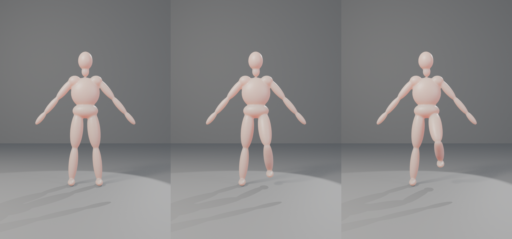

# Atelier guidé — Technical Director

Travaillez depuis une copie du projet P6 et gardez son correcteur séparé. Lisez les contraintes du bone dans le panneau Bone Constraints. [Pose test P6](../../06_RIGGING/PROJECT_P6/REFERENCE/renders/p6_posetest.png).

## 1. Reproduire

Sur une copie du rig, désactivez l’influence d’une contrainte IK utilisée par le pied, puis comparez deux poses. Notez version, image et contrôleur exact.

**Pourquoi** Une panne reproductible sépare symptôme, cause probable et preuve. Conservez une bonne scène pour le diagnostic.

**Contrôle** La version de défaut échoue à une action que la référence réalise.

## 2. Localiser

Inspectez chaîne de parentage, cibles, espace et ordre de contraintes. Vérifiez que le contrôle modifie le résultat évalué.

**Pourquoi** Un contrôle peut bouger tout en ne pilotant plus le bone de déformation. Le diagnostic suit le chemin des dépendances.

**Contrôle** Vous identifiez le lien rompu et éliminez une autre cause par une preuve.

## 3. Corriger et livrer

Rétablissez la contrainte. Testez pose neutre, pose extrême, transition et réouverture. Comparez l’orientation du pied et le parentage local.

**Pourquoi** Le rig livré doit préserver les plans existants. Le test de régression vérifie les comportements connus.

**Contrôle** Une fiche donne avant/après, procédure de migration et résultat de quatre tests.

## Vérification sur une variante

Dans une copie, supprimez l’effet d’une contrainte de l’atelier. Comparez deux poses, rétablissez l’influence et rouvrez le plan. Notez l’action précise qui reproduit et fait disparaître le défaut.
